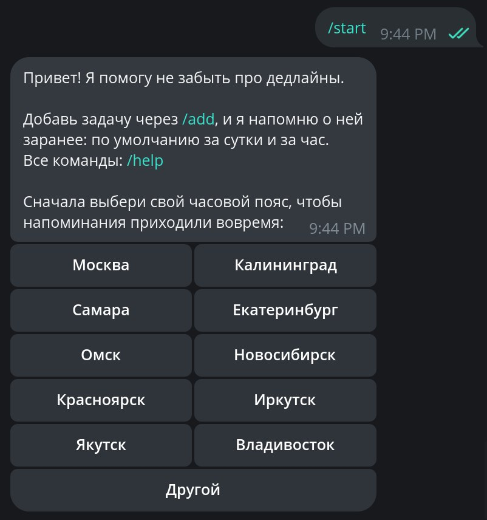
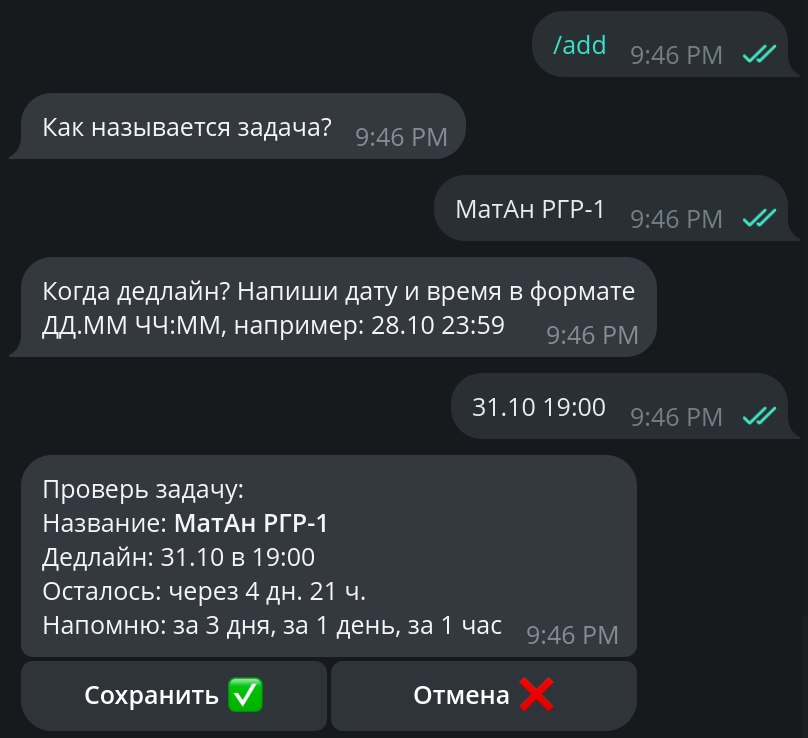
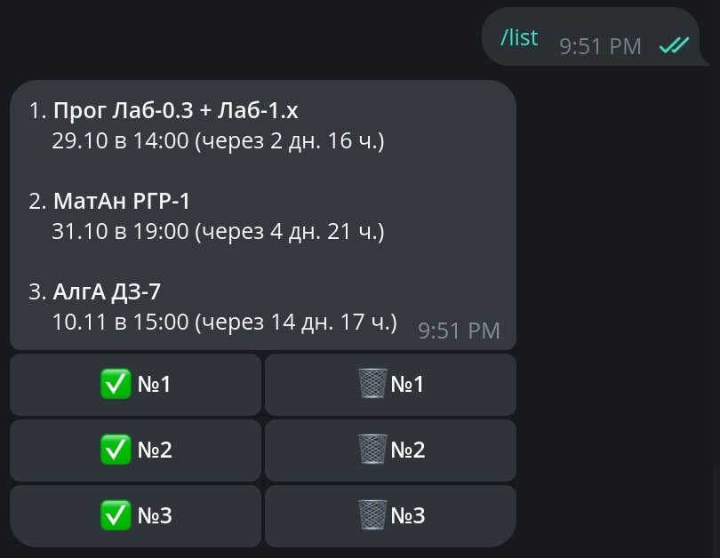
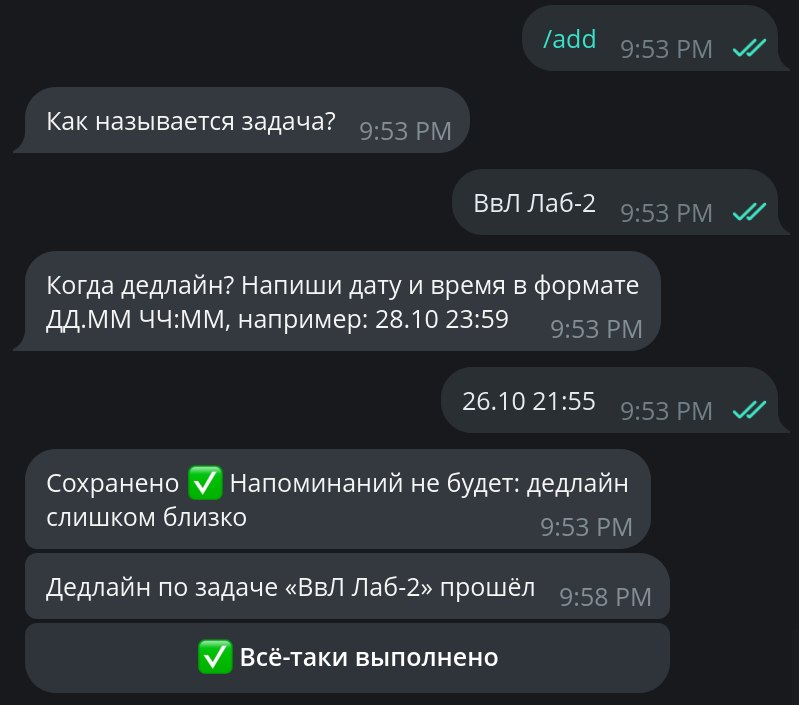
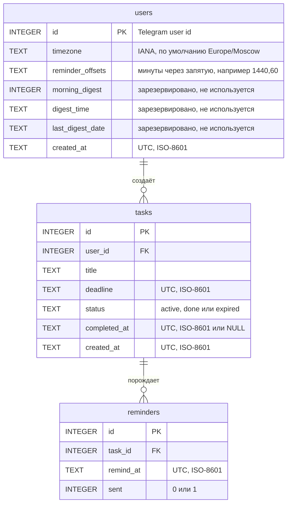

# Напоминалка о дедлайнах

Учебный Telegram-бот. Хранит дедлайны (учёба, работа) и сам напоминает о них в личных сообщениях: по умолчанию за сутки и за час до срока. Время хранится в UTC и показывается в часовом поясе пользователя. Напоминания не теряются при перезапуске бота.

Стек: Python, aiogram 3 (long polling), SQLite через aiosqlite (без ORM), APScheduler 3, pytest.

## Скриншоты

Вставьте свои скриншоты в `docs/screenshots/` и поправьте пути.

-  <!-- вставить: /start с кнопками часовых поясов -->
-  <!-- вставить: /add, сводка с кнопками «Сохранить» и «Отмена» -->
-  <!-- вставить: /list с кнопками ✅ и 🗑 -->
-  <!-- вставить: сообщение-напоминание с тремя кнопками -->

## Команды

| Команда | Что делает |
|---|---|
| `/start` | Приветствие, регистрация, выбор часового пояса |
| `/help` | Список команд |
| `/add` | Добавить дедлайн (название, дата и время, подтверждение) |
| `/list` | Активные дедлайны (до 10 ближайших) с кнопками «выполнено» и «удалить» |
| `/delete` | Тот же список, но только с кнопками удаления (с подтверждением) |
| `/today` | Дедлайны на сегодня |
| `/week` | Дедлайны на ближайшие 7 дней |
| `/settings` | Часовой пояс и интервалы напоминаний |
| `/cancel` | Прервать любой диалог |

Формат даты и времени при добавлении: `ДД.ММ ЧЧ:ММ` (например, `28.10 23:59`), допустимы также `ДД.ММ.ГГ` и `ДД.ММ.ГГГГ`, разделители `.`, `/`, `-`.

## Установка и запуск

Нужен Python 3.11 или новее (проект разрабатывался на 3.14).

1. Клонировать репозиторий и перейти в каталог проекта.
2. Создать виртуальную среду и активировать её:
   - Linux / macOS (bash, zsh): `python3 -m venv .venv && source .venv/bin/activate`
   - fish: `python -m venv .venv && source .venv/bin/activate.fish`
   - Windows (PowerShell): `python -m venv .venv` и `.venv\Scripts\Activate.ps1`
3. Установить зависимости: `pip install -r requirements.txt`
4. Создать бота: написать в Telegram [@BotFather](https://t.me/BotFather) команду `/newbot`, получить токен.
5. Скопировать `.env.example` в `.env` и вписать токен: `BOT_TOKEN=123456:ABC...`. Необязательно можно задать `DB_PATH` (по умолчанию `data/bot.db`) и `LOG_PATH` (по умолчанию `logs/bot.log`).
6. Запустить: `python bot.py`. Остановка: `Ctrl+C`.

Файл `.env`, база `data/` и логи `logs/` перечислены в `.gitignore` и в репозиторий не попадают.

## Структура проекта

```
deadline_bot/
├── bot.py             точка входа: логи, диспетчер, планировщик, long polling
├── config.py          настройки из .env и все константы проекта
├── database.py        вся работа с SQLite (чистый SQL, параметризованные запросы)
├── utils.py           чистые функции: разбор дат, часовые пояса, форматирование
├── texts.py           тексты сообщений и шаблоны (с экранированием HTML)
├── keyboards.py       фабрики inline-клавиатур
├── states.py          состояния FSM (диалоги /add и ввод часового пояса)
├── scheduler.py       фоновые задачи: отправка напоминаний, закрытие просроченных
├── handlers/
│   ├── start.py       /start, /help, выбор часового пояса (tz:, tz_other)
│   ├── tasks.py       /add (FSM), /cancel, /list, /delete, /today, /week
│   ├── callbacks.py   кнопки: выполнено, перенос на час и день, удаление
│   ├── settings.py    /settings: пояс и интервалы напоминаний
│   ├── errors.py      глобальный обработчик необработанных ошибок
│   └── fallback.py    ответ на непонятные сообщения вне диалога
├── tests/             pytest-тесты (см. раздел «Тесты»)
├── .env.example       пример файла настроек
├── requirements.txt   зависимости с точными версиями
├── pytest.ini         настройки pytest и вывода покрытия
└── .coveragerc        порог покрытия 90% и исключения
```

Служебные функции с префиксом `_` (например, `_connect`, `_resolve`, `_snooze`) и общие помощники `edit_text` и `is_command_in_dialog` это разбиение кода на небольшие части без повторов, а не новые возможности бота.

## Схема БД



- Все даты хранятся строками ISO-8601 в UTC, с точностью до секунды, поэтому их можно сравнивать как строки прямо в SQL.
- У внешних ключей `ON DELETE CASCADE`: удаление задачи удаляет её напоминания. Для этого каждое соединение выполняет `PRAGMA foreign_keys = ON`.
- Индексы: `idx_reminders_due (sent, remind_at)` для выборки наступивших напоминаний и `idx_tasks_user_status (user_id, status, deadline)` для списков.

## Как работает планировщик

Два фоновых задания APScheduler (`AsyncIOScheduler`), оба с `max_instances=1` и `coalesce=True`:

- `check_reminders` раз в `CHECK_INTERVAL_SECONDS` (30 секунд): берёт из БД все неотправленные напоминания с `remind_at <= сейчас` у активных задач, отправляет, затем помечает `sent = 1`. Между отправками пауза `SEND_PAUSE_SECONDS`.
- `expire_overdue_tasks` раз в `EXPIRE_INTERVAL_SECONDS` (5 минут): задачи, чей срок прошёл, получают статус `expired`, пользователю один раз приходит уведомление с кнопкой «Всё-таки выполнено».

**Что происходит при перезапуске.** Напоминания живут в таблице `reminders`, а не в памяти планировщика. После старта первый же тик `check_reminders` находит все неотправленные напоминания, время которых уже наступило, и отправляет их. Если напоминание опоздало больше чем на `LATE_REMINDER_MINUTES` (5 минут), в текст добавляется пометка «бот был недоступен, напоминание опоздало». Если срок самой задачи уже прошёл, напоминание просто закрывается без отправки. Кроме того, при старте один раз вызывается `expire_overdue_tasks`.

**Ошибки отправки.**

| Ситуация | Что делает бот |
|---|---|
| Пользователь заблокировал бота | WARNING в лог, напоминание помечается отправленным (не повторяется) |
| Лимит Telegram, ошибка сети, любая другая ошибка | WARNING или ERROR в лог, напоминание остаётся неотправленным, повтор на следующем тике |
| Ошибка при обработке одной записи | Логируется, остальные записи обрабатываются |

## Принятые решения

Таблица из ТЗ (раздел 4) плюс решения, принятые при разработке.

| Вопрос | Решение |
|---|---|
| Что делает «+1 час / +1 день» | Сдвигает дедлайн; неотправленные напоминания пересоздаются по интервалам пользователя (только будущие) |
| Год не указан в дате | Текущий год; дата раньше сегодняшней уходит на следующий год; время сегодня уже прошло: «Эта дата уже прошла» |
| Двузначный год | `ДД.ММ.ГГ` это `20ГГ` |
| Время `9:05` | Допустимо |
| Несуществующее время (переход на лето) | Ошибка «Такого времени в твоём поясе не бывает»; неоднозначное: первое вхождение (`fold=0`) |
| FSM после перезапуска | Состояние теряется (MemoryStorage) |
| Команда во время диалога (любое состояние FSM, кроме `/cancel`) | «Сначала закончи диалог или отправь /cancel», состояние сохраняется |
| Список задач | Одно сообщение, до 10 ближайших, внизу «…и ещё N. Заверши или удали часть задач» |
| Кнопки в `/list` | По строке на задачу: `[✅ №N] [🗑 №N]` |
| Просроченная задача | Статус `expired`, одно уведомление с кнопкой «✅ Всё-таки выполнено» |
| Лимит задач | 50 активных на пользователя |
| Отправка напоминания | Сначала отправить, потом `sent = 1` (at-least-once: возможен дубль, потеря исключена) |
| Сводка, `/stats`, `/export` | Не реализуются |
| `DB_PATH`, `LOG_PATH` | Берутся из `.env`, если заданы; иначе значения по умолчанию |
| Версии пакетов | В `requirements.txt` зафиксированы точные версии; `APScheduler` ветки 3.x (4.x имеет другой API) |
| Формат дат в БД | `isoformat(timespec="seconds")` от aware-UTC, доли секунды отбрасываются |
| `shift_task_deadline` и перенос кнопками | Только для задач `active`; для остальных «Задача не найдена» |
| `expire_overdue_tasks` в БД | Возвращает словари с ключами `task_id`, `user_id`, `title`, `deadline` |
| Поле `reminder_offsets` | В БД и в `get_or_create_user` это строка `'1440,60'`; разбирает её `utils.parse_offsets` |
| Параметр `tz` в `utils` | Имя пояса (строка IANA) или объект `ZoneInfo` |
| `plural_ru` | Возвращает только слово; число подставляет вызывающий код |
| `explain_datetime_error` | Для корректного ввода возвращает пустую строку |
| Время вне диапазона (`25:61`, `24:00`) | «Не понял формат»; несуществующий день или месяц: «Такой даты не существует» |
| `29.02` без года | Берётся текущий или следующий год; если в нём нет 29 февраля, ошибка (следующий високосный год не ищем) |
| Тексты ошибок разбора даты | Лежат в `texts.py` (`ERR_DT_*`) |
| Порядок роутеров | `tasks`, `callbacks`, `settings`, `start`, `errors`, `fallback` (последним) |
| Текст на шаге подтверждения `/add` | Напоминание нажать «Сохранить» или «Отмена» |
| Нажатие устаревшей кнопки (состояние не `waiting_confirm`) | Всплывающее сообщение «Эта кнопка устарела…», ничего не меняется |
| Дедлайн прошёл, пока пользователь решал, сохранять ли | Задача не сохраняется, пользователю предлагается начать заново |
| Текущее время в хендлерах и jobs | Берётся через `_now_utc()` (в `handlers/tasks.py`, `handlers/callbacks.py`, `scheduler.py`), в тестах подменяется |
| `/cancel` | Не обращается к БД |
| Активная задача, чей срок прошёл, но job ещё не пометил её `expired` | Показывается в списке с пометкой «просрочено» |
| Чужая и несуществующая задача в кнопках | Одинаковый ответ «Задача не найдена»; `get_task` их не различает, WARNING в логе пишется для обоих случаев |
| После удаления | Сообщение заменяется на «Удалено 🗑», список не обновляется |
| Кнопка «Нет» при удалении уже удалённой задачи | «Задача не найдена» |
| Пауза между отправками | `config.SEND_PAUSE_SECONDS = 0.05` (число вынесено в конфиг) |
| Уведомление о просрочке | Отправляется один раз; при ошибке отправки не повторяется |
| `expire_overdue_tasks` при старте | Вызывается один раз из `main()` после `delete_webhook()` |
| Часовой пояс текстом | Проверка через `ZoneInfo`; `ZoneInfoNotFoundError`, `ValueError` и `OSError` (например, «Europe» это каталог) считаются неверным вводом; пробелы по краям убираются, регистр важен |
| Кнопка `tz:<IANA>` с неизвестным именем | «Некорректная кнопка» |
| Перенос дедлайна кнопками | Новый дедлайн = старый + 1 час / 1 день; лимит `MAX_DEADLINE_DAYS` считается от текущего момента (ровно на границе разрешено) |
| Кнопка «Выполнено» | Сообщение заменяется на «Молодец! Задача выполнена ✅» (в `/list` заменяется весь список) |
| `/today` | Задачи текущих локальных суток пользователя; границы `[00:00, 24:00)` |
| `/week` | Сегодняшние локальные сутки и ещё 6 следующих (`config.WEEK_DAYS = 7`), тот же формат и лимит строк, что у `/list` |
| Пустой результат `/today` и `/week` | Свои сообщения |
| `/settings` | Меню из двух кнопок с текущими значениями; «Часовой пояс» использует те же `tz:` и `tz_other`, что и `/start` |
| Текущий пресет интервалов | Помечается ✅; если интервалы не совпадают ни с одним пресетом, не отмечено ничего |
| Смена интервалов | Касается только новых задач, существующие напоминания не пересоздаются |
| Глобальный обработчик ошибок | ERROR со стектрейсом в лог, пользователю «Что-то пошло не так, попробуй ещё раз»; ошибка при отправке этого ответа тоже глушится |
| `config.DEFAULT_TIMEZONE` | Справочная константа: фактическое значение по умолчанию задано в схеме БД; согласованность проверяет `test_database.py` |
| Длина строки | Код укладывается в 100 символов; в тестах несколько строк до 126 (длинные ожидаемые значения), без переносов |

**Почему UTC.** Один формат для всех пользователей, не зависит от перехода на летнее время, сравнение «наступило ли время» сводится к сравнению двух значений. В часовой пояс пользователя время переводится только при показе и при разборе ввода.

**Почему SQLite.** Один файл без отдельного сервера, этого достаточно для учебного бота с небольшой нагрузкой. Доступ идёт через `aiosqlite`, без ORM, чистым SQL с параметрами.

**Почему опрос раз в 30 секунд, а не job на каждое напоминание.** Источником правды остаётся таблица `reminders`: после перезапуска ничего не нужно восстанавливать, пересоздавать в планировщике или хранить во втором месте (`SQLAlchemyJobStore`). Точность до 30 секунд для напоминаний за сутки и за час вполне приемлема, а при переносе или удалении задачи нужно менять только строки в БД.

## Тесты

Запуск: `pytest` (без аргументов). Сразу печатается покрытие строк (`pytest-cov`, настройки в `pytest.ini` и `.coveragerc`). Если суммарное покрытие ниже 90%, `pytest` завершается с ошибкой. Токен бота и сеть для тестов не нужны: Telegram заменён заглушками (`AsyncMock`), БД создаётся во временной папке для каждого теста.

**Как читать отчёт.** Колонки: `Stmts` (сколько исполняемых строк), `Miss` (сколько из них не выполнилось ни в одном тесте), `Cover` (процент), `Missing` (номера невыполненных строк). Хорошо, когда `Miss` равен 0.

| Модуль | Тестовый файл |
|---|---|
| `config.py` | `tests/test_config.py` |
| `database.py` | `tests/test_database.py` |
| `utils.py` | `tests/test_utils.py` |
| `texts.py` | `tests/test_texts.py` |
| `keyboards.py` | `tests/test_keyboards.py` |
| `states.py` | отдельного файла нет (только описания состояний, без функций; используется во всех тестах диалогов) |
| `scheduler.py` | `tests/test_scheduler.py` |
| `bot.py` | `tests/test_bot.py` |
| `handlers/start.py` | `tests/test_handlers_start.py` |
| `handlers/tasks.py` | `tests/test_handlers_tasks.py` |
| `handlers/callbacks.py` | `tests/test_handlers_callbacks.py` |
| `handlers/settings.py` | `tests/test_handlers_settings.py` |
| `handlers/errors.py` | `tests/test_handlers_errors.py` |
| `handlers/fallback.py` | `tests/test_handlers_fallback.py` |
| общие фикстуры | `tests/conftest.py` |

**Итоговый вывод `pytest`:**

```
ВСТАВЬТЕ СЮДА ВЫВОД КОМАНДЫ `pytest` ЦЕЛИКОМ: таблицу покрытия и итоговую строку вида «466 passed in …».
```

**Строки без покрытия.** Из подсчёта намеренно исключены (`.coveragerc`, `exclude_lines`): функция `main()` в `bot.py` (помечена `# pragma: no cover`, для неё нужен реальный Telegram и запущенный event loop) и блок `if __name__ == "__main__":`. Если в вашем отчёте есть другие непокрытые строки, перечислите их здесь и объясните, почему они не проверяются.

## Ручной чек-лист для проверки в Telegram

1. `/start`: приветствие и кнопки часовых поясов. Выбрать город: сообщение заменится подтверждением. Повторить с кнопкой «Другой» и текстом `Europe/Berlin`; затем с заведомо неверным `Mars/Phobos` (бот просит повторить).
2. `/add`: ввести название и корректную дату (`28.10 23:59`) и сохранить. Затем неверные данные: пустое название, `abc`, `31.02 10:00`, прошедшая дата, дата дальше двух лет. Бот должен объяснять причину и не падать.
3. Напоминание: добавить дедлайн примерно через 2 минуты (чтобы не ждать) и дождаться напоминания с точностью до `CHECK_INTERVAL_SECONDS` (30 секунд). Либо сдвинуть напоминание в прошлое командой `python -c "import sqlite3; c = sqlite3.connect('data/bot.db'); c.execute('UPDATE reminders SET remind_at = ? WHERE sent = 0', ('2000-01-01T00:00:00+00:00',)); c.commit()"`, и оно придёт с пометкой об опоздании.
4. Под напоминанием: «✅ Выполнено» (задача пропадает из `/list`), «⏳ +1 час» и «📅 +1 день» (дедлайн переносится, в `/list` новое время).
5. `/list`, `/today`, `/week`: корректный состав и нумерация. `/delete` (и 🗑 в `/list`): подтверждение «Да, удалить» и «Нет».
6. Перезапуск: добавить задачу, сдвинуть её напоминание в прошлое командой из пункта 3, остановить бота (`Ctrl+C`), подождать минуту, запустить снова: напоминание должно прийти после старта.
7. Блокировка: с другого аккаунта (или на себе) заблокировать бота, добавить задачу заранее, дождаться напоминания. В логах должен появиться WARNING «Пользователь … заблокировал бота», бот при этом продолжает работать.
8. `/settings`: сменить интервалы на «только за 1 час», добавить новую задачу и убедиться, что в её сводке напоминание только за час.
9. Любой непонятный текст вне диалога: «Не понял. Список команд: /help».

## Известные ограничения и идеи развития

Ограничения:
- Состояния диалогов хранятся в памяти: после перезапуска бота незаконченный `/add` приходится начинать заново (старые кнопки подтверждения сообщат, что устарели).
- Бот работает через long polling в одном процессе; несколько экземпляров с одной БД не поддерживаются.
- Точность напоминаний около 30 секунд.
- `get_task` не различает чужую и несуществующую задачу, поэтому оба случая попадают в лог одинаково.
- Список ограничен 10 строками без постраничной навигации (так задумано в ТЗ).
- Названия задач хранятся как введены, без ограничения по содержимому (только длина до 100 символов).

Идеи развития:
- Утренняя сводка (колонки `morning_digest`, `digest_time`, `last_digest_date` в `users` уже есть).
- Команды `/stats` и `/export` в `.ics`.
- Постоянное хранилище FSM (например, Redis) и webhook вместо polling.
- Разбор фраз вида «завтра в 18:00».